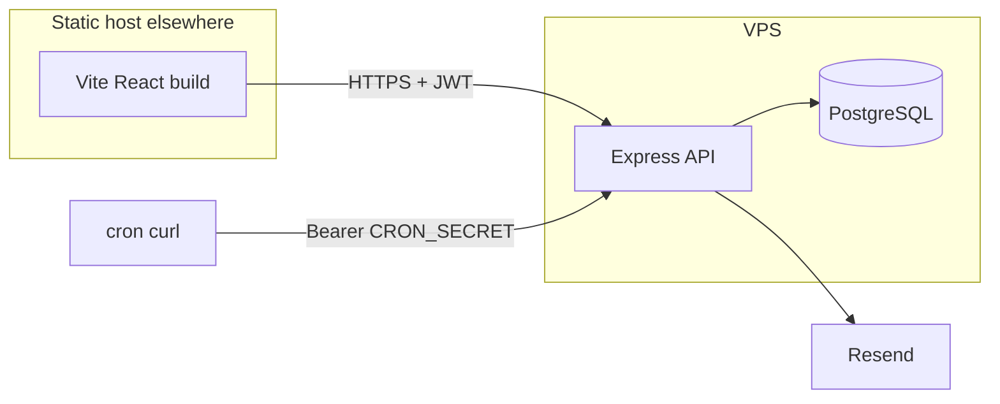

# Architecture

## Purpose

Describe how the API, dashboard, database, and scheduled jobs fit together.

## Key files

- API entry: [`../src/index.ts`](../src/index.ts)
- SSL logic: [`../src/lib/ssl/`](../src/lib/ssl/)
- Jobs: [`../src/lib/jobs/run-checks.ts`](../src/lib/jobs/run-checks.ts)
- Dashboard: separate repo (Vite + React SPA calling this API)

## Related docs

- [database.md](./database.md)
- [operations.md](./operations.md)
- [email-alerts.md](./email-alerts.md)

---

## Split: API vs client

The **API** holds all business logic and stays small (Express + Prisma). The **client** is a static SPA; build with `VITE_API_URL` pointing at your API.

## API routes

| Method | Path | Auth | Role |
|--------|------|------|------|
| GET | `/api/health` | none | Liveness |
| POST | `/api/auth/login` | none | Returns JWT |
| GET | `/api/overview` | JWT | Dashboard stats |
| CRUD | `/api/emails` | JWT | Notification emails |
| CRUD | `/api/urls` | JWT | Monitored hosts + email links |
| GET | `/api/urls/:id/checks` | JWT | Check history |
| POST | `/api/checks/run` | JWT | Manual full run |
| POST | `/api/jobs/daily-check` | `CRON_SECRET` | Scheduled checks |
| POST | `/api/jobs/weekly-report` | `CRON_SECRET` | Weekly email |

## Auth

- Single admin password from env (`DASHBOARD_PASSWORD` dev, `DASHBOARD_PASSWORD_HASH` production).
- Login returns a JWT; client stores it in `localStorage` and sends `Authorization: Bearer`.
- CORS allows only `CORS_ORIGIN` (your deployed frontend URL).

## Why not Next.js

Next.js bundles SSR, routing, and build tooling that increase RAM on a small VPS. This stack keeps the server process lean; the UI ships as static files on any CDN or host.
